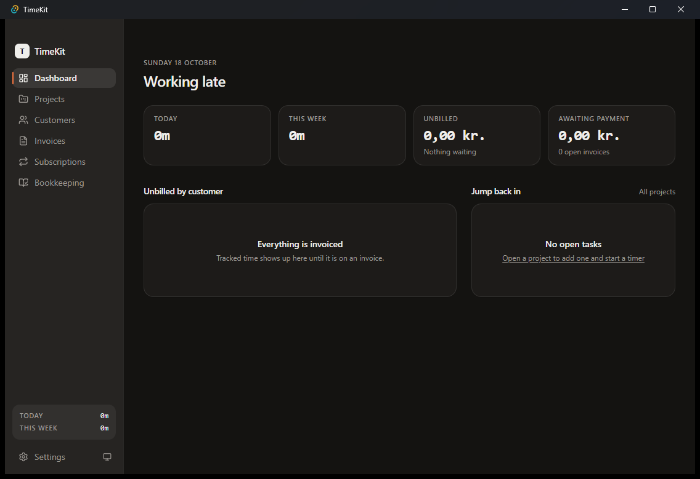

<h1 align="center">TimeKit</h1>

<p align="center"><b>Offline time tracking and invoicing for freelancers, on Mac and Windows.</b></p>

<p align="center">Track time on tasks, turn it into Danish-compliant PDF invoices, and keep the books. Optionally share one database between your machines through Turso.</p>

<p align="center">
  <a href="https://github.com/Matt3ws/timekit/actions/workflows/ci.yml"></a>
  
  
</p>

A desktop app built with Tauri 2, React 19 and SQLite. Everything runs locally: there is
no server and no account. Sync is optional and uses your own free Turso database.

<p align="center">
  
</p>

- **Time:** customers → projects → tasks, with a start/stop timer on any task. Only one timer
  runs at a time; entries stay editable after you stop them, and **Resume** continues a task.
- **Invoices:** one line per task, rounded up to 15 min, as PDFs in Danish or English (per
  customer). Credit notes instead of deletes, and one number series per customer.
- **Subscriptions:** monthly retainers that remind you on the 1st and preselect the month in
  New invoice.
- **Bookkeeping:** expenses with receipts, moms (VAT) tracking, the 50.000 kr registration
  limit, and a yearly export for the tax return.
- **Backups:** a full copy of the database to a folder of your choice, once a day.
- **Sync (optional):** the same data on your Mac and PC through Turso.

## Download

Get the installer from [Releases](../../releases):

| | File |
|---|---|
| **Mac** (Apple Silicon and Intel) | `TimeKit_<version>_universal.dmg` |
| **Windows** 10/11 x64 | `TimeKit_<version>_x64-setup.exe` |

Every CI run also uploads both installers as artifacts, kept for 14 days.

## Installing

**Mac**
- Open the `.dmg` and drag TimeKit to Applications.
- TimeKit is signed with its own certificate rather than a paid Apple one, so macOS can't
  verify the developer the first time. Go to *System Settings → Privacy & Security* and choose
  **Open Anyway**. You only do this once: every release is signed with the same certificate.

**Windows**
- Run the setup file. It installs for your user only (no admin needed) and adds TimeKit to
  the Start menu.
- The app isn't signed either. Windows may warn about it, and **Smart App Control** may block
  it outright.

Only one TimeKit runs at a time: starting it again brings the open window to the front.

**Updates:** TimeKit checks GitHub for a new release when it starts and once a day. When one is
out, **Update to <version>** appears in the sidebar: one click downloads it, installs it and
restarts TimeKit (a running timer keeps going). *Settings → Updates* shows the installed version,
has **Check now**, and can turn the automatic check off. Versions before 0.2.0 can't update
themselves: install 0.2.0 by hand once.

## Sync

Sync keeps one shared database in [Turso](https://turso.tech) and a local copy on each
machine.

**Setting it up**
1. Create a free Turso account and a database (any region; leave the *TursoDB* toggle off).
2. Copy the database URL (`libsql://…`) and create an auth token for it with read and write
   access and no expiry.
3. In TimeKit: *Settings → Sync*, paste both and click **Connect**. Do the same on the other
   machine.

**How it works**
- Reads come from the local copy, so lists and reports are instant and work offline.
- Writes (starting a timer, saving an invoice) go straight to Turso and then back to every
  machine. All machines write to the same database, so there are no merge conflicts and
  invoice numbers can never be issued twice.
- The local copy pulls new changes every 15 s, and whenever the window gets focus.
- **Offline:** if Turso can't be reached when TimeKit opens the database, you get the local
  copy read-only. Looking things up works; changes wait until **Try again** in Settings → Sync
  reconnects.
- Turning sync on doesn't upload anything. The local database stays untouched and comes
  back when you turn sync off.
- The URL and token live in `sync.json` on each machine, never in the shared database.

**Turso's free plan** (5 GB storage, 10 M rows written, 3 GB of syncs a month) is far more
than one person's time tracking needs. Reads hit the local copy and barely count.

**Not synced:** receipt files for expenses. The expense itself syncs, but the attached file
stays on the machine where you added it.

## Where things live

| | Mac | Windows |
|---|---|---|
| Data folder | `~/Library/Application Support/com.christiantangchristensen.timekit/` | `%APPDATA%\com.christiantangchristensen.timekit\` |

In that folder:
- `timekit.db`: the local database (sync off).
- `timekit-sync.db`: the local copy of the Turso database (sync on).
- `sync.json`: the Turso URL and token.
- `receipts/`, `invoices/`: receipt files and generated invoice PDFs.

## Rules TimeKit follows

These come from Danish bookkeeping rules, and the app enforces them:

- **Issued invoices are never deleted.** You cancel one with a credit note, which takes the next
  number in the customer's series and releases its time entries.
- **Billed time is locked.** A time entry on an invoice can't be edited or deleted, and neither
  can its task or project.
- **Every invoice number is unique.** Each customer has its own series (e.g. `Cc-FIN-00001`), and
  the counter only moves forward.
- **Money is stored in øre**, never as floating point. Hourly rates include moms, and the moms is
  calculated back out of the total.
- **Keep everything for 5 years.** The bookkeeping export collects income, expenses, receipts and
  every invoice PDF for a year.

## Building

Requires Node 24, pnpm and Rust (stable).

- **Mac:** Xcode command line tools (`xcode-select --install`).
- **Windows:** Visual Studio C++ Build Tools ("Desktop development with C++") and WebView2,
  which Windows 11 already has.

```
pnpm install
pnpm tauri dev          # run the app with hot reload
pnpm tauri build        # installer: .dmg on Mac, .msi/.exe on Windows
pnpm typecheck          # tsc --noEmit
pnpm test               # vitest: money, durations, billing, subscriptions, form fields
```

- The first `tauri` build takes a few minutes while Rust compiles; after that it's quick.
- With **Smart App Control** on, Windows blocks some freshly compiled release build files
  (`os error 4551`, or "can't find crate" for a proc-macro). `pnpm tauri build --debug --bundles nsis`
  reuses the development build and gives a working installer in
  `src-tauri/target/debug/bundle/nsis/`.
- **CI:** every push to `main` and every pull request runs the typecheck, the tests and a
  frontend build, then builds the app on macOS (universal `.dmg`) and Windows (NSIS installer)
  and uploads both installers. See [Releasing](#releasing) for how releases are published.

## Releasing

`main` only takes pull requests with a green CI run. When CI passes on `main` and the version
in `src-tauri/tauri.conf.json` has no GitHub release yet, the Release workflow builds both
installers, signs the Mac app and publishes them as `v<version>`. Merges without a version bump
release nothing.

1. In your pull request, run `pnpm bump 0.2.0`. It sets the version in `package.json`,
   `tauri.conf.json`, `Cargo.toml` and `Cargo.lock`.
2. Add a `## 0.2.0` section to `CHANGELOG.md`: it becomes the release notes. CI fails the
   pull request if the versions differ or the section is missing (`pnpm version:check`).
3. Merge. The release appears under [Releases](../../releases) once both builds finish.

**Signing:** the Mac app is signed with a self-signed certificate, "TimeKit Code Signing
(Christian Tang Christensen)", stored in the repository secrets `TIMEKIT_CERT_P12` (the `.p12`,
base64) and `TIMEKIT_CERT_PASSWORD`. Using the same certificate for every release keeps macOS
treating updates as the same app. A release with an unsigned Mac app fails instead of
publishing. The Windows installer isn't signed.

**Updates:** the release also publishes `TimeKit.app.tar.gz` and `latest.json`, which the in-app
updater reads from `releases/latest/download/latest.json`. Updates are signed with a separate
updater key (secrets `TIMEKIT_UPDATER_KEY` and `TIMEKIT_UPDATER_KEY_PASSWORD`). Its public half
is `plugins.updater.pubkey` in `tauri.conf.json`, and TimeKit refuses any update not signed
with it. If the key is lost, installed copies can't update any more and need a manual
install, so keep a copy of it somewhere safe. Only release builds create the update bundles,
so local builds and CI on pull requests don't need the key.

## Under the hood

- **Frontend:** React 19, TypeScript, Vite, TanStack Query and Router, shadcn/ui on Tailwind v4,
  and `@react-pdf/renderer` for the invoices.
- **Database:** Drizzle ORM builds the SQL in the WebView. Rust runs it with
  [libsql](https://github.com/tursodatabase/libsql), on the local file or the Turso embedded
  replica (`src-tauri/src/db.rs`). Multi-statement writes run as one transaction.
- **Migrations:** hand-written SQL in `src-tauri/migrations/`, applied at startup
  (`src-tauri/src/migrate.rs`).
- **Platforms:** macOS gets a translucent sidebar and an overlay title bar. Windows gets a plain
  window with the native title bar (`src-tauri/tauri.windows.conf.json`).

See [CLAUDE.md](CLAUDE.md) for the full architecture and conventions.

## Credits

TimeKit was created by Christian Tang Christensen. This fork adds Windows support, Turso sync
and CI.
